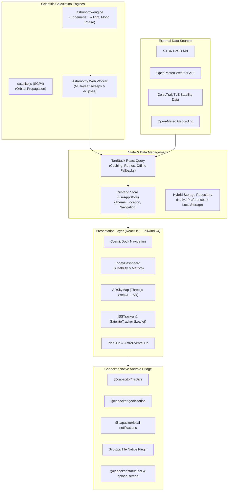

<div align="center">

# 🌌 SkyView: Moon & Space Tracker

**The modern, field-ready Android & Web astronomy companion for stargazers, astrophotographers, and space enthusiasts.**

[](https://react.dev/)
[](https://www.typescriptlang.org/)
[](https://vitejs.dev/)
[](https://capacitorjs.com/)
[](https://threejs.org/)
[](https://tailwindcss.com/)
[](https://vitest.dev/)
[](LICENSE)

<br />

[Features](#-key-features) • [Architecture](#-architecture--tech-stack) • [Directory Structure](#-project-structure) • [Getting Started](#-getting-started) • [Android Build](#-android-workflow-capacitor) • [Scripts](#-npm-scripts) • [Contributing](#-contributing)

</div>

---

## 🔭 Overview

**SkyView** is an Android-first astronomy workstation and observational guide engineered with **React 19**, **TypeScript**, **Vite**, **Tailwind CSS v4**, **Three.js**, and **Capacitor 8**. Built specifically for real-world nighttime field use, SkyView combines scientific ephemeris calculations, augmented reality sky guidance, real-time orbital satellite mechanics, and local meteorological metrics into a responsive, battery-conscious mobile interface.

Whether tracking lunar librations, calculating the optimal twilight window for deep-sky astrophotography, watching the International Space Station cross the meridian, or searching for planets in real-time AR, SkyView provides laboratory-grade astronomical precision at your fingertips.

---

## ✨ Key Features

### 🌌 3D & Augmented Reality (AR) Sky Map
- **Interactive Three.js Celestial Sphere**: Real-time WebGL rendering of the celestial sphere, ecliptic coordinates, celestial equator, and major constellations.
- **Sensor Fusion & Compass Guidance**: Smooth gyroscope, accelerometer, and magnetometer fusion tracking true heading, pitch, and roll with magnetic declination compensation.
- **Deep-Sky & Celestial Catalogs**: Extensive database of stars, planets, constellations with mythology artwork overlays, and Messier deep-sky objects (DSOs).
- **Astrophotography Framing**: Real-time camera FOV guides, angular separation calculators, and twilight photo windows.

### 🌕 High-Precision Moon & Solar Tracker
- **Photorealistic 3D Moon Renderer**: Real-time lunar phase visualization displaying terminator progression, moon age, and illumination percentage down to 0.1%.
- **astronomy-engine Ephemeris**: Sub-arcsecond astronomical calculations calculating moonrise, moonset, solar noon, transit times, and civil/nautical/astronomical twilight boundaries.
- **Full Lunar Calendar**: Interactive monthly phase calendar predicting upcoming new moons, full moons, supermoons, and quarter phases.

### 🛰️ Live Satellite & ISS Tracking
- **Interactive Orbital Ground Track**: Real-time ISS tracking rendered over global maps powered by Leaflet.
- **SGP4 TLE Propagation**: High-accuracy orbit propagation using `satellite.js` with live two-line element (TLE) datasets fetched from CelesTrak.
- **Pass Predictions & Notifications**: Next-pass horizon countdowns, maximum elevation azimuths, pass duration, and scheduled local push alerts.
- **Constellation Tracking**: Track bright satellites including Starlink trains, Hubble, Tiangong, and weather constellations.

### 🔭 Tonight's Observation Hub
- **Observation Suitability Score (0–100)**: Proprietary, dynamically calculated stargazing index combining real-time cloud cover, humidity, transparency, moon illumination, and Bortle light pollution scale.
- **Bortle Scale Light Pollution Map**: Global dark-sky rating system mapping your current location from Class 1 (pristine dark sky) to Class 9 (inner-city sky).
- **Hourly Cloud Cover Chart**: Granular meteorological forecast detailing low, mid, and high-altitude cloud layers from Open-Meteo.
- **Tonight's Recommended Targets**: Ranked list of planets, nebulae, galaxies, and star clusters optimized for your exact viewing window.

### 🪐 Astro Events Calendar & NASA APOD
- **Comprehensive Event Forecast**: Meteor shower peaks (with Zenithal Hourly Rate / ZHR estimations and radiants), lunar and solar eclipses, and planetary conjunctions.
- **Dedicated Astronomy Web Worker**: Off-main-thread compute worker evaluating multi-year eclipse searches and 60-day planetary sweep cycles without dropping UI frames.
- **Daily NASA APOD**: Direct integration with NASA's Astronomy Picture of the Day API, offering high-definition imagery, full metadata, and offline image caching.

### 🌙 Field-Ready Nighttime Design
- **Scotopic Red-Light Night Vision**: True hardware-friendly red-light interface that preserves dark-adapted human vision during field observations.
- **Android Quick Settings Scotopic Tile**: Instant toggle of red-light mode directly from the Android system notification tray via native Capacitor plugin bridge.
- **Screen Wake Lock**: Prevents the display from sleeping during long telescope alignment and observation sessions.
- **Tactile Haptic Feedback**: Sensory micro-vibrations via `@capacitor/haptics` indicating target lock, cardinal compass snapping, and button activations.
- **Resilient Offline Caching**: Dual-layer storage repository (browser fallback + `@capacitor/preferences`) ensuring full functionality even in remote dark-sky zones without internet connectivity.

### 🌍 Internationalization (i18n) & Accessibility
- **8 Fully Supported Languages**: English (`en`), Turkish (`tr`), German (`de`), French (`fr`), Spanish (`es`), Italian (`it`), Portuguese (`pt`), and Arabic (`ar`).
- **Native RTL Architecture**: Full right-to-left layout direction, mirror icons, and typography spacing for Arabic.
- **Accessibility & Focus**: Strict ARIA compliant modal dialogues, focus traps, screen-reader status banners, and scalable fonts.

---

## 🏗️ Architecture & Tech Stack



### Core Technologies

| Category | Technology | Purpose |
|:---|:---|:---|
| **Framework** | [React 19](https://react.dev/) | Modern UI runtime with concurrent mode, transitions, and Suspense |
| **Language** | [TypeScript 5.8](https://www.typescriptlang.org/) | Strict static typing, custom domain types, and zero-compromise type safety |
| **Build Tool** | [Vite 6](https://vitejs.dev/) | Ultra-fast ESM compilation, hot-module replacement, and production bundling |
| **Styling** | [Tailwind CSS v4](https://tailwindcss.com/) | High-performance CSS engine with semantic tokens and scotopic theming |
| **3D & Graphics** | [Three.js 0.185](https://threejs.org/) | GPU-accelerated celestial sphere rendering and projection math |
| **Astronomy** | [astronomy-engine](https://github.com/cosinekitty/astronomy) | Ephemeris, rise/set times, twilight calculation, coordinate transformations |
| **Orbital Mechanics** | [satellite.js](https://github.com/shashwatak/satellite-js) | SGP4/SDP4 satellite orbit propagation from two-line element sets |
| **Mapping** | [Leaflet](https://leafletjs.com/) | Lightweight, touch-optimized mapping for ground track visualization |
| **Native Runtime** | [Capacitor 8](https://capacitorjs.com/) | Cross-platform native Android container and system hardware plugins |
| **State Management** | [Zustand 5](https://github.com/pmndrs/zustand) | Lightweight, selector-optimized global state management |
| **Data Fetching** | [TanStack React Query v5](https://tanstack.com/query) | Async state caching, network revalidation, and background data synchronization |
| **Data Validation** | [Zod 4](https://zod.dev/) | Runtime schema validation for all external API endpoints |
| **Animations** | [Motion](https://motion.dev/) | Fluid gestures, spring animations, and view transitions |
| **Testing** | [Vitest 4](https://vitest.dev/) | High-speed unit and integration test runner with mocking facilities |

---

## 📁 Project Structure

```text
skyview/
├── android/                    # Capacitor Android Studio native project
│   ├── app/                    # Native Android application source and manifests
│   └── build.gradle            # Native Gradle build scripts
├── assets/                     # App branding, icons, and static visual assets
├── src/
│   ├── components/             # Reusable UI primitives (CosmicDock, Modal, Toast, Skeleton)
│   ├── context/                # React context providers (TimeMachine, Theme)
│   ├── data/                   # Astronomical catalogs (stars, constellations, DSOs, descriptions)
│   ├── domain/                 # Domain logic and Observer contexts
│   ├── features/               # Domain-driven feature modules
│   │   ├── astronomy/          # Moon Phase Calendar, NASA APOD, Meteor Showers
│   │   ├── core/               # TodayDashboard, SkyHub, PlanHub, SectionTabs
│   │   ├── observation/        # Suitability Score, Light Pollution, Cloud Chart, Targets
│   │   ├── satellites/         # ISS Live Tracker, SGP4 Satellite Tracker, Ground Tracks
│   │   ├── settings/           # App Preferences, Location, Notification Settings
│   │   ├── sky/                # Celestial search and object discovery
│   │   └── sky-map/            # 3D AR Sky Map, Three.js GPU scene, camera tracking, HUD
│   ├── hooks/                  # Custom React hooks (useCompass, useWakeLock, usePullToRefresh)
│   │   └── queries/            # React Query hooks (useWeatherQuery, useAstroEventsQuery)
│   ├── locales/                # Internationalization dictionaries (EN, TR, DE, FR, ES, IT, PT, AR)
│   ├── native/                 # Capacitor native bridges (ScotopicTile, RichNotifications, Alerts)
│   ├── observability/          # Runtime diagnostic reporting and performance monitoring
│   ├── repositories/           # Abstract storage and offline cache implementations
│   ├── schemas/                # Zod validation schemas for all external APIs
│   ├── services/               # API service clients (Open-Meteo, NASA, CelesTrak, Geocoding)
│   ├── store/                  # Zustand stores (useAppStore, toastStore)
│   ├── utils/                  # Astronomy utilities, math, haptics, theme, date-time helpers
│   ├── workers/                # Web Workers for heavy background astronomical math
│   ├── App.tsx                 # Root application container & system integrations
│   ├── main.tsx                # Application bootstrap entry point
│   └── types.ts                # Global TypeScript definitions
├── .env.example                # Template for environment variables
├── capacitor.config.ts         # Capacitor native application configuration
├── package.json                # Project dependencies and script declarations
├── tailwind.config.ts          # Tailwind CSS styling and color configurations
├── tsconfig.json               # TypeScript compiler configuration
├── vite.config.ts              # Vite bundler configuration
└── vitest.config.ts            # Vitest test runner configuration
```

---

## 🚀 Getting Started

### Prerequisites

Ensure the following tools are installed on your machine:
- **Node.js**: `20.x` or higher (LTS recommended)
- **npm**: `9.x` or higher
- **Android Studio** (Optional, required only for native Android builds) with Android SDK platform 34+ and bundled JDK 17+
- A modern browser with **WebGL** support (Chrome, Firefox, Edge, Safari)

### Installation & Setup

1. **Clone the repository**:
   ```bash
   git clone https://github.com/your-username/skyview.git
   cd skyview
   ```

2. **Install project dependencies**:
   ```bash
   npm install
   ```

3. **Configure Environment Variables**:
   Copy the example environment file:
   ```bash
   cp .env.example .env
   ```
   Open `.env` and configure your API keys:
   ```env
   # NASA APOD: Used for Astronomy Picture of the Day requests.
   # Generate a free API key at https://api.nasa.gov/
   VITE_NASA_API_KEY="DEMO_KEY"
   ```
   *(Note: The app will work with `DEMO_KEY`, but obtaining your own free key from NASA avoids rate limits).*

4. **Start the local development server**:
   ```bash
   npm run dev
   ```
   Open your browser and navigate to `http://localhost:3000`.

---

## 📱 Android Workflow (Capacitor)

SkyView is built with an Android-first architecture. Follow these steps to build and run the native APK on an Android device or emulator:

### 1. Build the Web Distribution Bundle
Compile the TypeScript code and optimize assets for production:
```bash
npm run build
```

### 2. Synchronize Web Assets with Android Platform
Copy the web build (`dist/`) and sync native Capacitor plugins:
```bash
npx cap sync android
```

### 3. Open in Android Studio
Launch Android Studio with the configured Android container:
```bash
npx cap open android
```

### 4. Run & Debug
- Connect an Android device with **USB Debugging** enabled or boot an Android Virtual Device (AVD).
- Press **Run** (`Shift + F10`) in Android Studio.
- Ensure camera and fine location permissions are granted for full AR and ephemeris accuracy.

---

## 📜 NPM Scripts

| Script | Command | Purpose |
|:---|:---|:---|
| **`npm run dev`** | `vite --port=3000 --host=0.0.0.0` | Starts the local dev server with HMR accessible across your local network |
| **`npm run build`** | `vite build` | Compiles and tree-shakes production bundles into `dist/` |
| **`npm run preview`** | `vite preview` | Runs a local web server to preview the production build output |
| **`npm run lint`** | `eslint "src/**/*.{ts,tsx}" && tsc --noEmit` | Executes strict ESLint rules and TypeScript type checking |
| **`npm run test`** | `vitest run --config vitest.config.ts` | Runs the full Vitest unit, regression, and integration test suite |
| **`npm run clean`** | `node -e "..."` | Cross-platform script to purge generated `dist/` and build artifacts |

---

## 🧪 Testing & Quality Assurance

SkyView maintains a comprehensive test suite covering mathematical ephemeris algorithms, coordinate transformations, TLE orbital propagation, caching strategies, and internationalization integrity:

```bash
# Run all tests once
npm run test

# Run tests in watch mode
npx vitest

# Run type check and linter
npm run lint
```

---

## 🤝 Contributing

Contributions to **SkyView** are warmly welcomed! Please read our [CONTRIBUTING.md](CONTRIBUTING.md) guide for details on:
1. Development environment setup.
2. Code style & formatting guidelines (TypeScript strict mode, Zod validation, semantic color tokens).
3. Conventional commit message formats (`feat:`, `fix:`, `docs:`, `refactor:`, `test:`).
4. Submitting pull requests.

---

## 📄 License

This project is licensed under the **MIT License** — see the [LICENSE](LICENSE) file for details.

---

<div align="center">
<sub>Built with 🔭 for astronomy lovers across the globe. Clear skies!</sub>
</div>
