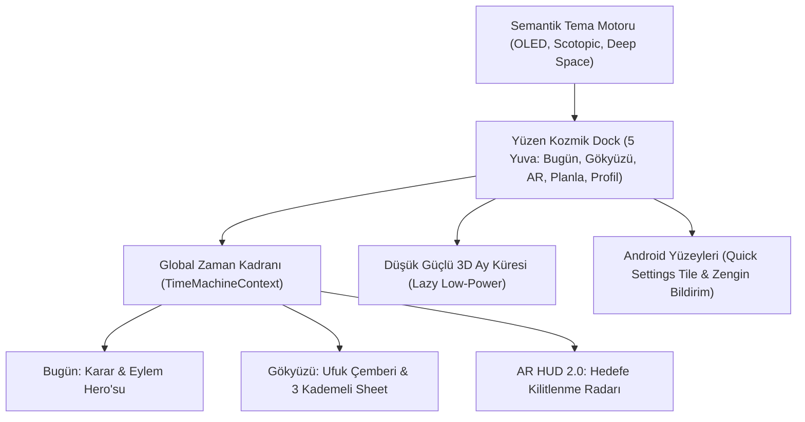

# SkyView — Birleştirilmiş Master UI/UX Yol Haritası (v5.0)

> **Belge Türü:** 4 Farklı Yapay Zekâ Vizyonunun (Argon/Flash 3.8, GLM 5.3, DeepSeek 4.1, Manus) Birleştirilmiş, Ayıklanmış ve Tekilleştirilmiş Master Yol Haritası  
> **Tarih:** 19 Ekim 2026  
> **Platform:** Android-first (Capacitor 8 + React 19 + Tailwind v4 + Three.js + Motion v12)  
> **Mühendislik Referansı:** `ROADMAP.md` (49 test dosyası / 222 test / sıfır hata kalite ağı)

---

## 🧭 0. Yönetici Özeti ve Kuzey Yıldızı

> **Kuzey Yıldızı:**  
> *"Cebinden çıkardığında bu gecenin gözlem kararı tek ekranda; gökyüzüne kaldırdığında evrenin üzerine çizilmiş taktiksel bir kılavuz."*

SkyView; hassas astronomi algoritmaları, meteor takvimleri, uydu yörüngeleri ve AR HUD ile teknik olarak rüştünü ispatlamış bir altyapıya sahiptir. Ancak önceki ekranlar, bilgiyi eşit ağırlıklı paneller halinde sunan "sakin bir veri panosu" gibi davranmaktaydı. 

Bu birleştirilmiş yol haritası; gereksiz fantezileri, pil tüketen animasyonları ve karmaşık menüleri ayıklayarak; **saha ergonomisi**, **zamanın tek bir eksende akması (Global Zaman Kadranı)** ve **karanlıkta göz kamaştırmayan taktiksel bir gökyüzü aleti** deneyimini tek bir master planda birleştirir.

---

## 🔍 1. De-Duplication & Ayıklama Raporu

Öneriler titizlikle karşılaştırılmış, çakışanlar sentezlenmiş ve gereksiz olanlar elenmiştir:

| Konu | İncelenen Öneriler | Birleştirilmiş / Nihai Karar |
|---|---|---|
| **Karanlık / Kırmızı Mod** | Flash 3.8 (Obsidian Red), GLM (Scotopic profil), DeepSeek (Token tabanlı scotopic), Manus (Saha kırmızı ışığı) | **Tek Bir Token Tabanlı Tema Motoru:** Kırılgan `!important` beyaz listesi kaldırılır. 4 modlu semantik tema kurulur: `Deep Space`, `OLED #000000`, `Scotopic Kırmızı (630nm)` ve `Daylight`. SVG ve haritalara monokrom kırmızı filtre uygulanır. |
| **Zaman Yönetimi** | Flash 3.8 (Time Scrubber), GLM (Global Time Machine 2.0), DeepSeek (Gece Şeridi) | **Tek Global Zaman Ekseni (`TimeMachineContext`):** Zaman kaydırıldığında Bugün, Gökyüzü Haritası, Hava Grafiği ve Hedefler tek bir parmak hareketiyle senkron güncellenir. |
| **AR ve Saha Vizörü** | Flash 3.8 (Target Lock Pointer), GLM (Taktiksel Kilitleme), DeepSeek (AR Navigasyon Merkezi), Manus (Saha Güvenilirliği) | **AR HUD 2.0 & Hedefe Kilitlenme:** 5 yuvalı navigasyonun merkezinde doğrudan AR erişimi. Seçilen gök cismine dinamik yönlendirme oku, azimut/yükseklik farkı, hedefe girince haptik klik ve FOV (dürbün/teleskop) simülasyonu. |
| **Bugün Ekranı** | 4 modelin tamamı dikey kart yığınından şikayetçi | **Karar → Eylem → Ayar Hiyerarşisi:** İlk bakışta tek bir somut karar ("21:30–00:45 arası ideal"), gözlem skoru halkası ve tek bir belirgin "Bu Geceyi Planla" veya "Gökyüzünde Gör" eylemi. |
| **3D Görselleştirmeler** | Flash 3.8 & GLM (3D Ay ve Gezegenler), DeepSeek (Ay Laboratuvarı), Manus (Ölçülü 3B) | **Düşük Güçlü 3D Ay Küresi:** Sürekli çalışan ağır animasyonlar reddedildi. Three.js `powerPreference: 'low-power'` ile yalnızca karta tıklandığında lazy yüklenir, kapatılınca sahne bellekten tamamen silinir. |
| **Mobil Navigasyon** | Flash 3.8 (Floating Dock + 3 kademeli sheet), DeepSeek (5 yuvalı nav + multi-stop sheet) | **Yüzen Kozmik Dock + 3 Kademeli BottomSheet:** Kenarlardan boşluklu yüzen alt bar + detaylar için `peek (120px)`, `half (%50)`, `expanded (%92)` çekmece. |

### ❌ Ayıklanan ve Kapsam Dışı Bırakılan Maddeler:
1. **Zorunlu Hesap, Sosyal Ağ & Bulut Senkronizasyonu (Reddedildi):** Gözlem sahasında internet çekmeyebilir. Kullanıcı mahremiyeti ve çevrimdışı öncelik (offline-first) esastır. Sadece yerel çalışan "Story Görseli Dışa Aktar" özelliği tutuldu.
2. **Ortam Işığı Sensörü ile Otomatik Kırmızı Mod (Reddedildi):** WebView kısıtları, pil harcaması ve istikrarsızlık nedeniyle iptal edildi; gün batımı/astronomik alacakaranlık saati bazlı akıllı öneri ve tek dokunuş düğmesi tercih edildi.
3. **Sürekli Arka Plan Parçacık Animasyonları & Yıldız Yağmurları (Reddedildi):** Teleskop başında pil ömrü kritiktir; CPU/GPU'yu sürekli yoran boş görsel süslemeler elendi.
4. **Yeni Font Eklenmesi (Reddedildi):** Mevcut `Outfit` (UI) ve `JetBrains Mono` (Veri) ikilisi mükemmeldir; fazladan bundle boyutu yaratılmayacaktır.

---

## 🎯 2. Temel Tasarım İlkeleri

1. **Alet Hissi, Oyuncak Değil:** Bilimsel dürüstlük, net birimler ve belirsizliklerin şeffaf gösterimi. Sahte kesinlik yok.
2. **Saha Gerçekleri:** Karanlık, soğuk, tek el, eldiven, OLED pil tasarrufu ve düşük parlaklık tasarımın ana girdisidir.
3. **Tek Zaman Ekseni:** Gece boyunca zamanı kaydırmak, tüm uygulamayı aynı zihinsel modelde çalıştırır.
4. **Dahil Edici ve Standart Tipografi:** 12px altına inen minik yazılar (`7-9px`) yasaktır; eldivenle ve uzaktan rahatça okunur.

---

## 🛠️ 3. Birleşik Mimari ve Bileşen Çerçevesi



### A. Semantik Tema Motoru 2.0 (Tek Dokunuş Kırmızı Mod)
- **Token Katmanı:** Ham Tailwind sınıfları yerine anlamsal `--sv-*` token'ları (`--sv-bg`, `--sv-surface`, `--sv-brand`, `--sv-text-muted`).
- **4 Canlı Tema:**
  1. `Deep Space` (Varsayılan derin lacivert-siyah `#010204`)
  2. `OLED` (Tamamen kapanan pikseller `#000000`)
  3. `Scotopic` (Karanlık adaptasyonunu koruyan monokrom kızıl 630nm — sıfır mavi/yeşil sızıntısı)
  4. `Daylight` (Gündüz planlama için yüksek kontrastlı aydınlık tema)
- Kırılgan `!important` CSS beyaz listesi tamamen çöpe atılır; tema tek bir `data-theme` özniteliğiyle tüm bileşenlere pürüzsüzce akar.

### B. Başparmak Ergonomisi: Yüzen Dock & 3 Kademeli BottomSheet
- **5 Yuvalı Yüzen Kozmik Dock:**
  `Bugün` · `Gökyüzü` · **[ 🌟 AR Vizör (Büyük Merkez Buton) ]** · `Planla` · `Profil`
- **3 Kademeli Draggable BottomSheet:**
  Bir gök cismine dokunulduğunda tam ekran modal açılmaz. Alttan yumuşakça süzülen çekmece:
  - `Peek (120px):` Hedef adı, parlaklık (mag), yön oku ve "AR'da Gör" butonu.
  - `Half (%50):` Yükselim grafiği, batış saati, optik önerisi (çıplak göz/dürbün/teleskop).
  - `Expanded (%92):` Detaylı efemeris, mitoloji, bilimsel veriler ve gözlem notu ekleme.

### C. Global Zaman Kadranı (Night Ribbon Time Machine)
- Ekranın alt kısmında akıcı bir dairesel/yay zaman kaydırıcı.
- Kullanıcı parmağını kaydırdıkça:
  - Gece Skoru canlı hesaplanır.
  - Gök cisimlerinin ufuktaki yükseklikleri değişir.
  - Bulut durumu ve ay ışığı kirliliği anlık güncellenir.
  - ISS ve uydu geçiş anları rozet olarak zaman çizgisinde parlar.

### D. "Bu Gece" Karar Paneli (Karar → Eylem → Ayar)
- **Karar:** "En iyi gözlem aralığı: 22:15 – 01:30" (Bulut: %10, Ay: Batmış, Skor: 85/100).
- **Eylem:** Tek ana CTA: "Bu Geceyi Oturuma Dönüştür" veya "En Parlak Hedefe Git (Satürn)".
- **Ayar:** Havanın kötü olduğu gecelerde pasif uyarı yerine aktif alternatif sunumu: "Hava bulutlu; bu gece APOD keşfi yapabilir veya haftalık meteor zirvesini planlayabilirsin."

### E. Taktiksel AR HUD 2.0 (Hedefe Kilitlenme Vizörü)
- **Target Lock Pointer:** Listeden veya haritadan seçilen nesne AR'da dinamik bir hedef okuyla gösterilir. Telefon hedefe yaklaştıkça yön oku küçülür, hedef vizöre girdiğinde çift haptik darbe ile **"Kilitlendi ✓"** bildirimi verilir.
- **Dürbün & Teleskop Görüş Alanı (FOV Simülatörü):** Ekrana bindirilen 7x50 dürbün (7°) veya 25mm teleskop göz merceği dairesi ile gerçek saha simülasyonu.
- **Sensör Sönümleme:** Jiroskop/pusula titremelerini yok eden donanımsal low-pass filtreleme.

### F. Düşük Güçlü 3D Ay Laboratuvarı
- Dokunmatik 360° döndürülebilir Ay modeli.
- Anlık güneşe göre hesaplanan gerçek terminatör (gölge çizgisi).
- Dokunulabilir POI pinleri: Apollo iniş bölgeleri, Artemis hedefleri, Tycho ve Copernicus kraterleri.
- Kapatıldığında Three.js geometrileri ve dokuları bellekten temizlenerek pil ve RAM korunur.

### G. Android Native Yüzeyleri & Saha Kiti
- **Android Quick Settings Tile:** Hızlı ayarlar çekmecesinden tek tıkla "Kırmızı Mod Feneri".
- **Canlı Kilit Ekranı / Zengin Bildirim:** "ISS 12 dakika sonra güneybatıdan geçecek (Maks: 68°)" formatında yörünge grafiği içeren zengin bildirim.
- **Saha Çantası Kontrol Listesi:** Kırmızı fener, yedek batarya, buğu önleyici, göz mercekleri için yerel kontrol listesi.

---

## 📅 4. Birleştirilmiş Fazlı Uygulama Yol Haritası

```
F1 ███   Semantik Tema Motoru 2.0 + Tipografi Islahı (min 12px)  (M)
F2 ████  Yüzen Kozmik Dock + 5 Yuvalı Navigasyon + BottomSheet    (M–L)
F3 ███   Bugün Ekranı: Karar Paneli + Global Zaman Kadranı        (M–L)
F4 ████  Taktiksel AR HUD 2.0: Hedefe Kilitlenme Radarı + FOV    (L)
F5 ███   Düşük Güçlü 3D Ay Laboratuvarı + Zengin Uydu Kartı      (M)
F6 ██    Mikro-Etkileşimler, Saha Haptikleri + Android Yüzeyleri (M)
```

---

### 📍 FAZ 1 — Semantik Tema Motoru 2.0 & Tipografi Islahı
*Efor: M (Orta) · Risk: Düşük · Kalite Kapısı: 0 lint / 222 test yeşil*

- [ ] **1.1. Tema Motoru Altyapısı:**
  - `index.css` içindeki `.night-mode-active ... !important` blokları sökülür.
  - CSS değişkeni seviyesinde 4 profil: `deep-space`, `oled` (`#000000`), `scotopic` (kırmızı 630nm) ve `daylight`.
  - SVG'ler, Leaflet harita karoları ve medya öğeleri scotopic modda kırmızı monokrom filtreye bağlanır.
- [ ] **1.2. Tipografi ve Okunabilirlik Islahı:**
  - 12px altındaki tüm minik fontlar (`--text-5xs: 7px`, `--text-4xs: 8px`, `--text-3xs: 9px`) tasfiye edilir.
  - Asgari metin boyutu 12px yapılır; sayılar ve koordinatlar `JetBrains Mono` tabular düzene çekilir.
  - %130 ve %200 metin ölçeklendirme dayanıklılığı test edilir.
- [ ] **1.3. Ortak Atomik Bileşenler:**
  - Yarı saydam `CosmicCard`, `GlassPill` ve yüksek kontrastlı butonlar standart token'lara bağlanır.

---

### 📍 FAZ 2 — Ergonomik Navigasyon & Draggable BottomSheet
*Efor: M–L (Yarım Gün - 1 Gün) · Kalite Kapısı: Geri tuşu LIFO kaydı korunmalı*

- [ ] **2.1. 5 Yuvalı Yüzen Kozmik Dock:**
  - Ekranın alt kenarından 10px havada duran kavisli yüzen dock:
    1. *Bugün* 2. *Gökyüzü* 3. **[ 🌟 AR Vizör (Vurgulu Buton) ]** 4. *Planla* 5. *Profil*
  - Aktif sekme geçişinde akıcı kapsül animasyonu (`layoutId="dockPill"`).
- [ ] **2.2. Çok Duraklı Draggable BottomSheet Bileşeni:**
  - Mevcut modal altyapısını genişleterek `peek (120px)`, `half (%50)`, `expanded (%92)` duraklı sürükleme mekaniği.
  - Harita ve gökyüzü görünümünü engellemeyen (non-blocking) etkileşim katmanı.
- [ ] **2.3. Spotlight Gökyüzü Araması:**
  - Başparmak hizasında tek dokunuşla açılan hızlı hedef arama ve filtreleme ("Şu An Ufukta Olanlar", "Çıplak Gözle Görülenler").

---

### 📍 FAZ 3 — Bugün Karar Paneli & Global Zaman Kadranı
*Efor: M–L · Kalite Kapısı: Saat kaydırmada <150ms tepki süresi*

- [ ] **3.1. `TimeMachineContext` (Global Zaman Ekseni):**
  - Tüm astronomik hesaplamaları tek bir zaman imlecine bağlayan global bağlam.
  - Yay şeklinde (Arc Slider) dokunsal tıkırtılı gece kaydırıcısı.
- [ ] **3.2. Bugün Karar Hero Kartı:**
  - Eşit ağırlıklı kart yığınının sadeleştirilmesi: Tek bakışta "En İyi Gözlem Aralığı" (Örn: 22:30–01:15).
  - Skor halkası animasyonu (CountUp) + tek büyük "Planı Başlat" eylemi.
- [ ] **3.3. En Parlak 3 Hedef Sinematik Vitrini:**
  - Bu gece kullanıcının konumundan en net görülecek hedeflerin yatay kaydırmalı hızlı kartları.

---

### 📍 FAZ 4 — Taktiksel AR HUD 2.0 & Hedefe Kilitlenme
*Efor: L (1 Gün) · Kalite Kapısı: Cihazda açı ve yön doğrulaması*

- [ ] **4.1. Hedefe Kilitlen & Yönlendir (Target Lock):**
  - Listeden seçilen hedefe gitmek için ekranda beliren yönlendirme radarı ve mesafe göstergesi.
  - Hedef ekrana girdiğinde çift haptik titreşim (`successHaptic`) ve görsel odaklanma halkası.
- [ ] **4.2. FOV & Optik Simülatörü:**
  - Ekrana bindirilebilen 7x50 dürbün veya teleskop göz merceği görüş halkaları.
- [ ] **4.3. Jiroskopik Damping (Sönümleme):**
  - Sensör titremelerini yok eden yumuşak low-pass filtreleme ile sabit duran takımyıldız çizgileri.
- [ ] **4.4. Dürüst Sensör Geri Bildirimi:**
  - Manyetik sapma veya sensör kalitesi düşük olduğunda sahte kesinlik üretmeyen dürüst kalibrasyon uyarısı.

---

### 📍 FAZ 5 — Düşük Güçlü 3D Ay Laboratuvarı & Uydu Kartları
*Efor: M · Kalite Kapısı: Lazy Three.js render & bellek temizliği (dispose)*

- [ ] **5.1. Dokunulabilir 3D Ay Küresi:**
  - Kullanıcının parmağıyla 360° inceleyebileceği, anlık güneş açısıyla aydınlanan 3D Ay.
  - Önemli krater ve iniş bölgelerine dokunulduğunda açılan kısa bilgi etiketleri.
  - Modal kapandığında WebGL bağlamının ve Three.js geometrilerinin tamamen bellekten silinmesi.
- [ ] **5.2. ISS & Uydu Geçiş Yayı:**
  - Leaflet haritasına ek olarak, ufukta izleyeceği yolu gösteren minimalist gökyüzü yayı (Sky Arc).

---

### 📍 FAZ 6 — Mikro-Etkileşimler, Saha Haptikleri & Android Entegrasyonu
*Efor: M · Kalite Kapısı: TalkBack ve Android 14+ uyumluluğu*

- [ ] **6.1. Zenginleştirilmiş Saha Haptikleri:**
  - Pusula kuzeye hizalandığında mikro klik, zaman kadranında mekanik çark hissi, kilitlenmede çift vuruş.
- [ ] **6.2. Android Quick Settings Tile:**
  - Android bildirim çubuğuna eklenebilen tek tıkla "Kırmızı Fener / Scotopic Mod" karosu.
- [ ] **6.3. Zengin Bildirimler:**
  - ISS geçişi ve meteor zirvelerinde mini grafik içeren zengin bildirim kartları.
- [ ] **6.4. Paylaşılabilir Kozmik Gözlem Kartı:**
  - Bu gece görülen hedefleri Instagram/WhatsApp Story formatında dışa aktaran yerel görsel üretici.

---

## 🏁 5. Uygulama Sırası ve Başlangıç Önerisi

Uygulamaya başlarken en mantıklı ve en az riskli sıra:
1. **Adım 1:** **Faz 1 (Tema Motoru 2.0 & Tipografi Islahı)** — Görsel temeli düzeltir, kırılgan CSS'i temizler, diğer tüm adımların rengini besler.
2. **Adım 2:** **Faz 2 (Yüzen Kozmik Dock & 5 Yuvalı Navigasyon)** — Kullanıcının AR'ye ve araçlara tek dokunuşla ulaşmasını sağlar.
3. **Adım 3:** **Faz 3 (Bugün Karar Hero'su & Zaman Kadranı)** — Ana sayfayı modern bir karar merkezine dönüştürür.
4. **Adım 4:** **Faz 4 (Taktiksel AR HUD 2.0)** — Sahada hedefe kilitlenme radarını tamamlar.
